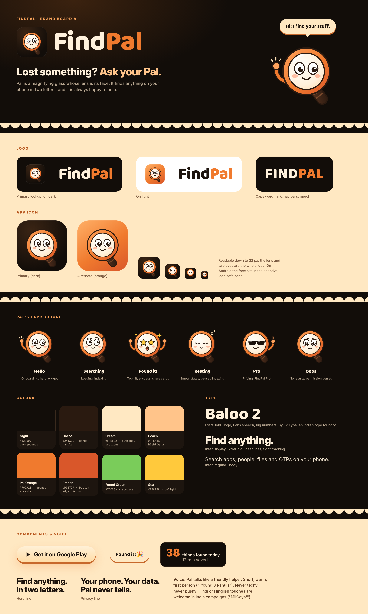

# FindPal brand

- **Mascot:** Pal, a magnifying glass whose lens is its face. Six expressions in `mascot/`
  (PNG 600 px and SVG): Hello, Searching, Found it!, Resting, Pro, Oops.
- **Logo:** `findpal-logo-dark.png`; wordmark set in Baloo 2 ExtraBold, "Pal" in Pal Orange.
- **App icon:** `findpal-icon-512.png` (primary, dark) and `findpal-icon-512-orange.png`.
- **Colours:** Night #120D09 · Cocoa #2A1A10 · Cream #FFE8C2 · Peach #FFC48A ·
  Pal Orange #F07A2E · Ember #D9572A · Found Green #7ACC5A · Star #FFC93C.
- **Type:** Baloo 2 ExtraBold (logo, Pal's speech, big numbers; Ek Type, SIL Open Font License),
  Inter Display ExtraBold (headlines), Inter (body).
- **Voice:** friendly helper, short and warm, first person. Hero line: "Find anything. In two
  letters." Privacy line: "Your phone. Your data. Pal never tells."

Regenerate everything with `node docs/brand/source/board.js` (needs Playwright and the Baloo 2
TTFs from Google Fonts in `docs/brand/source/fonts/`).
